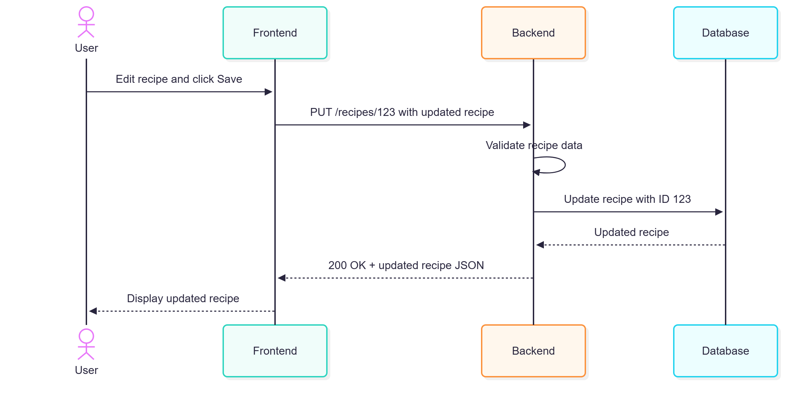
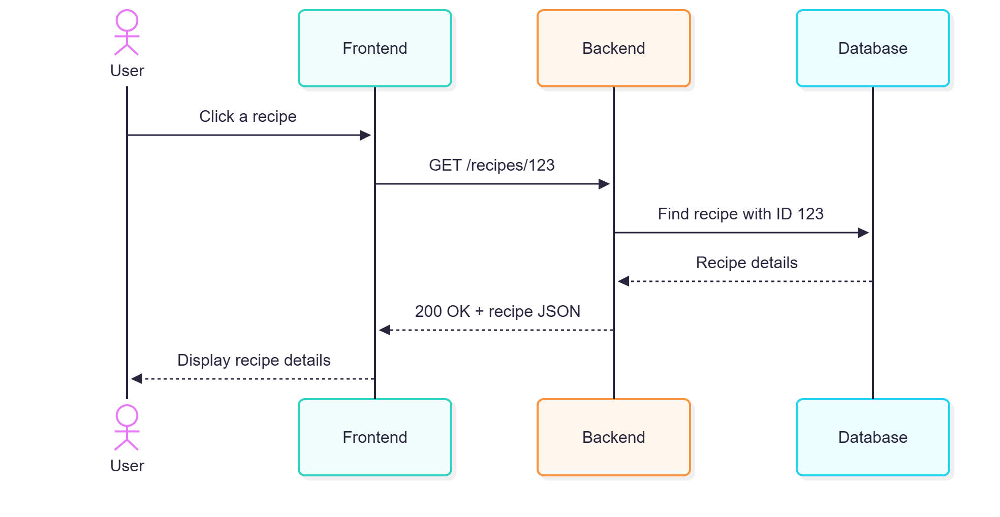
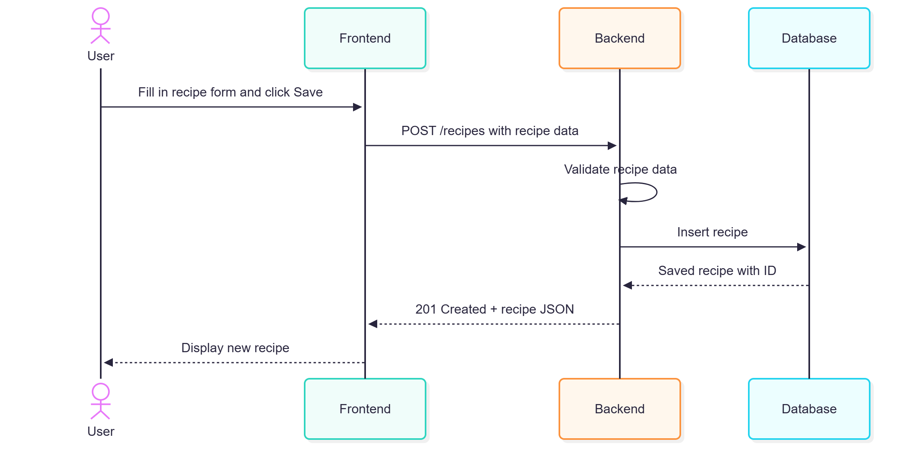

# Recipe Collection App
This app lets users add, view, edit and delete their favourite recipes.
## Adding a recipe
The user fills in the form and clicks Save. The frontend sends POST /recipes. The backend checks and saves the data in the database, then returns 201 Created with the saved recipe. The frontend displays it.
## Viewing recipes
The frontend uses GET /recipes to show all recipes. When the user clicks a recipe, it sends GET /recipes/123. The backend gets that recipe from the database and returns 200 OK with its details.
## Editing a recipe
The user changes the details and clicks Save. The frontend sends PUT /recipes/123. The backend checks and updates the recipe in the database, then returns 200 OK with the updated recipe. The frontend shows the changes.
## Deleting a recipe
The frontend sends DELETE /recipes/123. The backend deletes the recipe from the database and returns 204 No Content. The frontend removes it from the page.

Here, 123 is an example recipe ID.

## Diagrams

